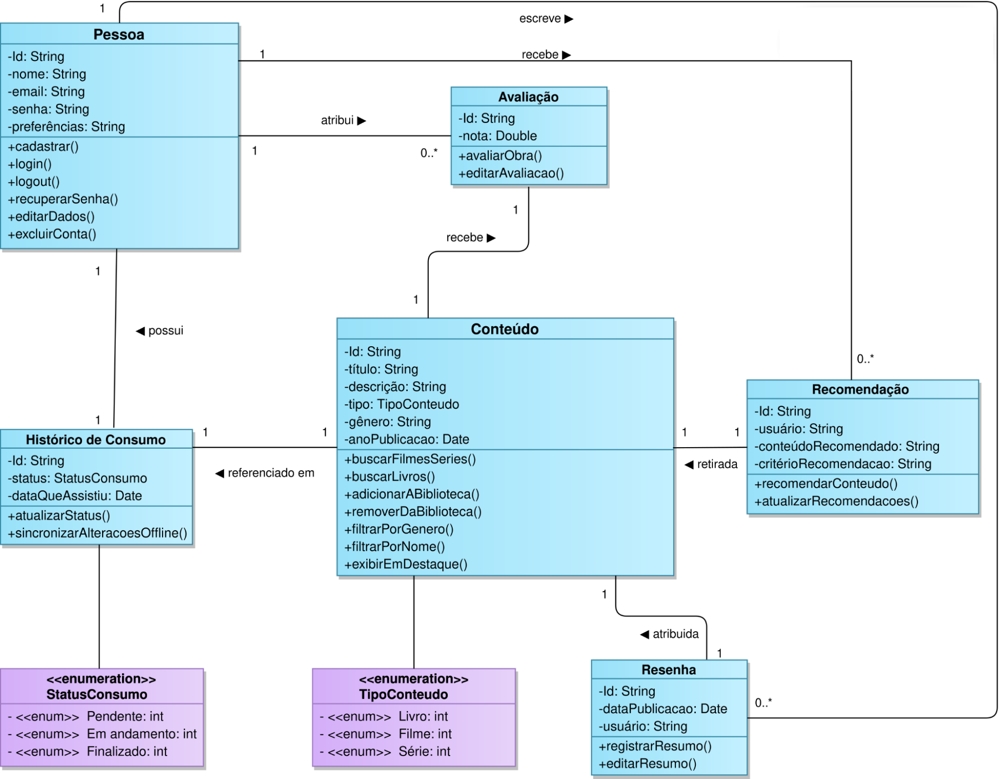
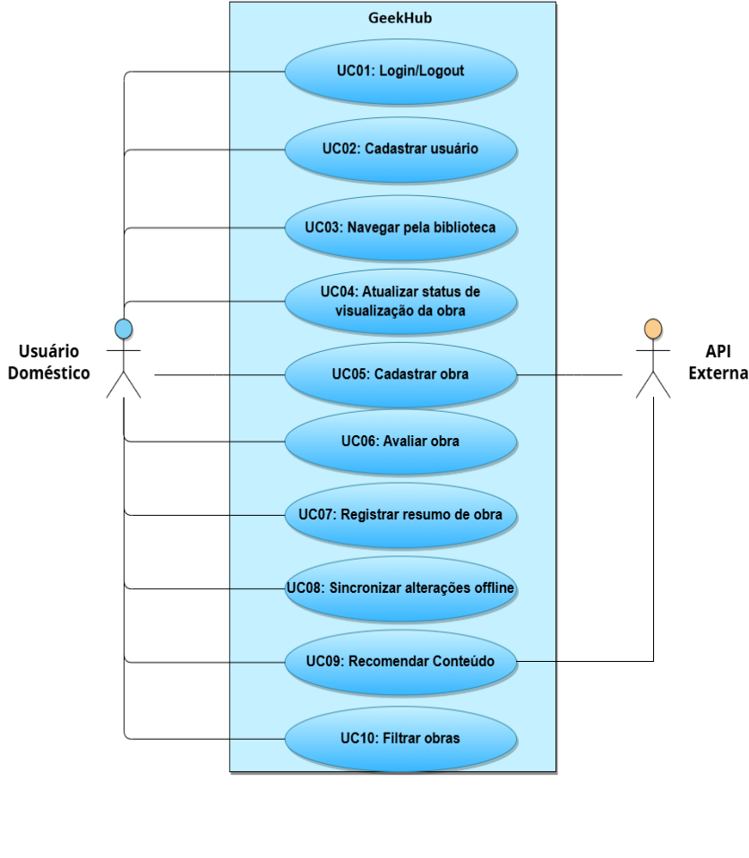

# Geek Hub

O Geek Hub é um aplicativo para organizar filmes, séries e livros em uma biblioteca pessoal. Cada pessoa entra com sua própria conta e acompanha os itens que deseja assistir ou ler.

## O que você pode fazer

- Criar uma conta e entrar com e-mail e senha.
- Adicionar, editar e acompanhar filmes, séries e livros.
- Organizar os itens por status, nota, data, resumo e categorias.
- Pesquisar filmes e séries no TMDB e livros no Google Books.
- Ver recomendações de filmes e séries em alta.
- Consultar a biblioteca associada à conta conectada.

## Tecnologias

- Next.js 16, React 19 e TypeScript.
- Firebase Authentication para contas e login.
- Cloud Firestore para armazenar as bibliotecas.
- TMDB e Google Books para pesquisa e informações de títulos.
- Docker Compose para executar o projeto em um contêiner.

## Arquitetura e Engenharia de Software

O projeto foi concebido a partir de uma **Especificação de Requisitos de Sistema (ERS v4.0)** formalizada antes e durante o desenvolvimento, cobrindo levantamento de requisitos funcionais/não funcionais, regras de negócio, modelagem UML e casos de teste.

### Decisões Arquiteturais e Regras de Negócio
* **Isolamento e Privacidade (LGPD):** Cada biblioteca pessoal é estritamente vinculada ao identificador único do usuário autenticado via Firebase Authentication, bloqueando leitura ou alteração cruzada de dados e permitindo exclusão completa da conta e registros associados.
* **Integridade de Domínio:** Prevenção de duplicidade de obras na biblioteca individual, validação de escala quantitativa (notas restritas de `0` a `5`), limite de tamanho em resenhas (`2000` caracteres) e máquina de estados controlada para consumo (`Pendente`, `Em andamento`, `Finalizado`).
* **Resiliência e Sincronização Offline:** Alterações de status realizadas sem conexão são persistidas localmente com marcação temporal (*timestamp*) e sincronizadas automaticamente em segundo plano com o Cloud Firestore após o restabelecimento da rede.
* **Interoperabilidade com APIs Externas:** Integração desacoplada para resolução de metadados audiovisuais (**TMDB API**) e bibliográficos (**Google Books API**), além de motor de recomendação baseado em popularidade agregada.

### Modelagem UML

#### Modelo de Domínio (Diagrama de Classes)


#### Requisitos Funcionais (Diagrama de Casos de Uso)



## Requisitos

Escolha uma das formas de execução:

- **Execução local:** Node.js 20 ou mais recente e npm.
- **Execução com Docker:** Docker Desktop instalado e aberto.

Para usar login e salvar a biblioteca, também é necessário configurar um projeto Firebase. Para pesquisas e recomendações, são necessárias chaves das APIs externas indicadas na seção de configuração.


## Executar localmente

No terminal, a partir da pasta do projeto:

```powershell
npm ci
npm run dev
```

Abra [http://localhost:3000](http://localhost:3000) no navegador. Se você alterar o arquivo `.env.local` enquanto o projeto estiver rodando, reinicie o servidor para carregar os novos valores.

## Executar com Docker

Abra o Docker Desktop e, no terminal dentro da pasta do projeto, execute:

```powershell
docker compose up --build -d
```

O aplicativo ficará disponível em [http://localhost:3000](http://localhost:3000). O projeto é montado no contêiner durante o desenvolvimento, então alterações nos arquivos normalmente aparecem sem recriar a imagem.

Comandos úteis:

```powershell

docker compose logs -f web

docker compose restart web

docker compose down
```

Se você mudar dependências ou arquivos de configuração do Docker, recrie a imagem com `docker compose up --build -d`.

## Verificações

Para executar o verificador de código:

```powershell
npm run lint
```

Para criar uma versão de produção:

```powershell
npm run build
```

Depois da compilação, a versão de produção pode ser iniciada com:

```powershell
npm start
```

## Organização do projeto

- [`app/`](./app): páginas e rotas da aplicação.
- [`components/`](./components): componentes visuais reutilizados pelas páginas.
- [`docs/`](./docs): diagramas UML de arquitetura e modelagem do sistema.
- [`lib/`](./lib): configuração do Firebase e funções compartilhadas.
- [`public/`](./public): ícones, manifesto e outros arquivos públicos.
- [`docker-compose.yml`](./docker-compose.yml): configuração para executar o projeto com Docker Compose.
